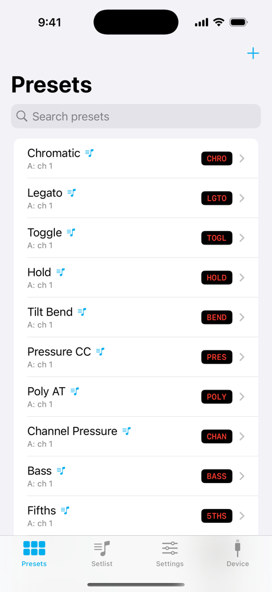
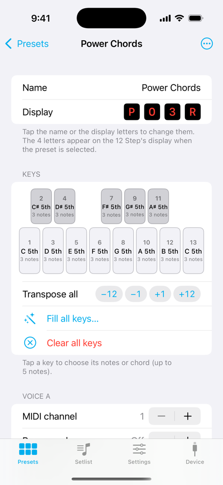
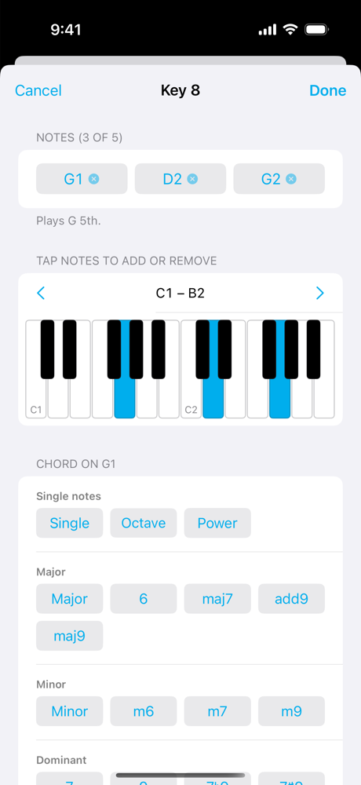
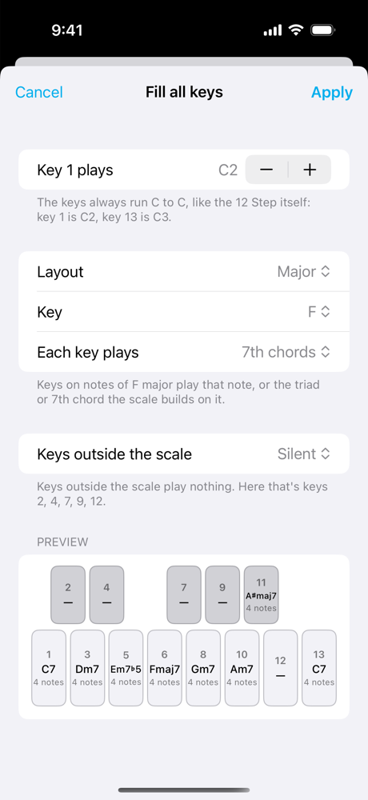
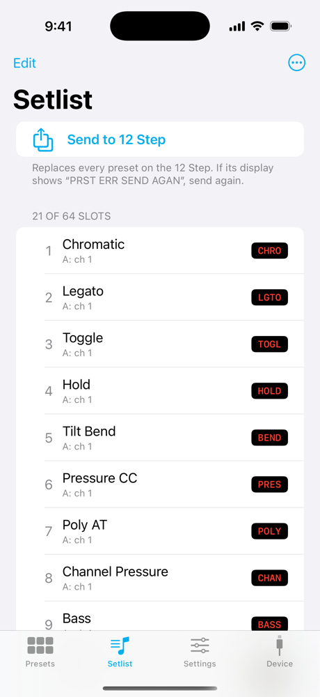

# 12 Step Editor for iOS

An iPhone and iPad editor for the **12 Step** MIDI foot controller by Muse Kinetics (Keith McMillen Instruments). Plug the 12 Step into your phone over USB-C, edit presets, chords and the setlist, and send them to the pedal. You don't need a computer.

<p>
  
  
  
  
  
</p>

> **Status:** preparing the first App Store release. Everything below works and has been tested on a real 12 Step2 (firmware 1.0.9) with an iPhone 16 Pro.

## What it does

- **Covers everything the desktop 12 Step Editor does to presets, the setlist and global settings**, using the same files, so presets move freely between the two.
- **Easier note assignment.** You see the 13 keys as they sit on the pedal, each showing its chord name.
  - Tap a key to pick notes on a small piano or choose a chord: major, minor, dominant (including 7♯9 and altered), suspended, diminished and augmented.
  - **Fill all keys** builds a whole preset at once from a scale and key, for example "F major, 7th chords". You choose what the keys outside the scale do.
- **Sends to the 12 Step over USB-C.** Setlist and settings uploads are byte-for-byte identical to the desktop editor's. Settings changes take effect on the pedal as you make them, as they do on the desktop.
- **Shares presets with the desktop editor on a Mac** through iCloud Drive, optionally. The free **12 Step Sync** Mac app (in this repo) sets that up in one click.
- **Touch and hold** any setting's name for an explanation, written from the official manual.
- **Demo mode** (Device tab) lets you try the app without a 12 Step.

**Not included:** firmware updates, and the pedal and CV calibration tools. Use the desktop editor for those.

## Compatibility

| | Tested | Expected to work |
|---|---|---|
| Controller | 12 Step2, firmware 1.0.9 | Original 12 Step (untested) |
| Device | iPhone 16 Pro, iOS 26 | Any iPhone or iPad with USB-C, iOS 17 or later |

The 12 Step is class-compliant USB MIDI, so the app uses Core MIDI and needs no drivers.

## Is it safe for my pedal?

The app only ever sends the same messages the official desktop editor sends: read-only queries, setlist uploads and settings uploads. A setlist upload replaces the presets on the 12 Step, exactly as the desktop's "Send Setlist" does. The app asks before doing it. It never sends firmware or bootloader commands, and a safety check in code refuses anything that isn't on that list.

## Sharing presets with the desktop editor (optional)

1. On your Mac, build and open **12 Step Sync**: `Tools/sync-setup/build-app.sh` makes `Tools/sync-setup/dist/12 Step Sync.app`. Click **Turn On iCloud Sync**. It:
   - backs up the desktop editor's presets;
   - copies them to `iCloud Drive/12 Step Editor`;
   - points the desktop editor at that folder.

   It never modifies the desktop editor app itself, and **Turn Off Sync** undoes it.
2. In the iOS app, tap **Set Up Sync** on the Presets tab (or **Settings › Sync with Your Mac…**), then pick **iCloud Drive › 12 Step Editor**.

Quit the desktop editor while editing on the phone, because it doesn't notice outside changes. If the desktop editor ever says a file is missing, choose **Exit Application**, never **Factory Default**.

## Building

Requirements: Xcode 16 or later. The app targets iOS 17.

- **App:** open `TwelveStepEditor.xcodeproj`, choose your team under Signing & Capabilities, pick a device, then press ⌘R. Without a 12 Step, turn on **Demo mode** on the Device tab.
- **Tests:** `cd TwelveStepKit && swift test` (protocol, file format and editing logic, including golden upload bytes from the official editor).
- **12 Step Sync (Mac):** `cd Tools/sync-setup && swift test && ./build-app.sh`

```
TwelveStepEditor/            SwiftUI app (Presets, Setlist, Settings, Device)
TwelveStepKit/               Swift package with no UI: MIDI transport, 12 Step protocol, preset files
Tools/sync-setup/            12 Step Sync, the Mac app for iCloud sharing
Tools/golden-harness/        builds the official editor's formatter to produce reference upload bytes
Tools/mac-sync/              older Terminal-script version of 12 Step Sync
```

## Acknowledgements

- Muse Kinetics publishes the source of the [official 12 Step Editor](https://github.com/Muse-Kinetics/12-step-editor-qt6) under MPL-2.0. This app's protocol and upload code is translated from it, and the factory presets come from it.
- The [12 Step manual](https://files.musekinetics.com/pub/products/12Step/editor/Manual/) is the source for the in-app help.

## Licence

Source-available: **free for noncommercial use**, and commercial use needs permission.
- **Most of the project:** [PolyForm Noncommercial 1.0.0](LICENSES/PolyForm-Noncommercial-1.0.0.md).
- **Stays [MPL-2.0](LICENSES/MPL-2.0.txt):** the files derived from the official editor.
  - `Protocol/KMIFraming.swift`
  - `Protocol/PresetImageFormatter.swift`
  - `Resources/FactoryPresets/`
  - `Tools/golden-harness/`

Each source file's header says which licence applies. See [`LICENSE.md`](LICENSE.md) for details, including the terms for contributions.

The app collects no data; see [`PRIVACY.md`](PRIVACY.md).

12 Step is a trademark of Muse Kinetics (Keith McMillen Instruments), used with permission. This is an independent project, not made by Muse Kinetics.
